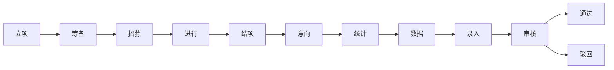
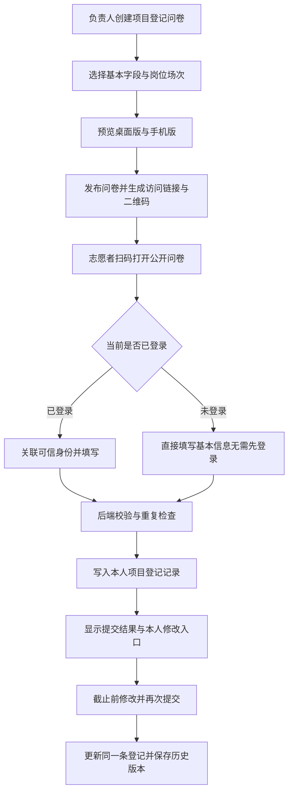
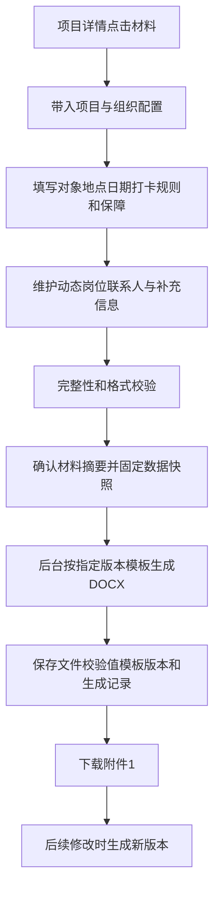
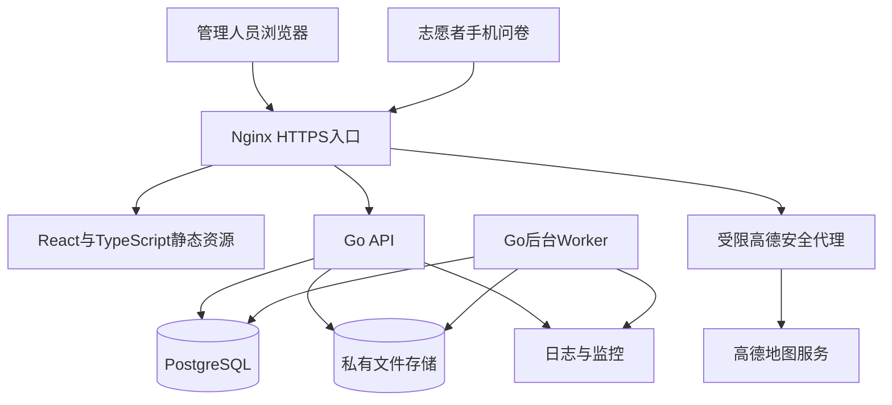

# 高校志愿服务项目管理平台建设项目书

> 版本：V1.0（需求与技术方案初稿）  
> 编制日期：2026年10月24日  
> 建设对象：学校及学院志愿服务管理部门  
> 技术路线（2026-11-06更新）：Go（Gin + GORM）+ PostgreSQL（开发环境 SQLite）+ React + TypeScript  
> 设计方向：白蓝主色、简约清晰、适合学校业务管理与正式交付

## 一、项目概述

### 1.1 建设背景

目前，志愿服务项目主要通过 WPS 表格维护，记录项目名称、数据组负责人、涉及部门、活动起止时间、活动地点、时长通过时间、状态和项目描述。项目招募、人员信息收集、时长处理及立项材料制作分散在不同工具中，存在重复录入、进度难以追踪、多人协作易冲突、批量处理效率低等问题。

本项目拟将上述流程迁移到统一网页平台，以项目台账为入口，贯通项目立项、筹备、志愿者登记、活动计时、时长统计、材料生成、录入跟踪和审核归档。

### 1.2 建设目标

1. **台账网页化**：承接现有 WPS 字段，支持查询、筛选、排序、分工和历史数据迁移。
2. **流程可追踪**：保留现有十二种业务状态，记录状态变更、处理人员、时间和原因。
3. **招募统一登记**：支持手动单条录入、手动批量录入和问卷登记，将志愿者信息归入对应项目。
4. **扫码填写与修改**：问卷生成访问二维码，同时支持已登录和未登录人员填写；填写者能够查看并修改本人提交的信息，不以学校SSO登录作为登记前提。
5. **时长批量记录**：支持人工登记、批量录入、补录及调整志愿服务小时数，并形成可复核的明细；不提供系统实时计时。
6. **材料自动生成**：基于已有材料助手的附件1模板与业务规则，生成学校使用的立项申请表。
7. **系统便于维护**：采用前后端分离架构、明确的数据模型和接口契约，便于学校接管和后续扩展。

### 1.3 核心业务口径

| 概念 | 本项目中的含义 |
|---|---|
| 项目 | 管理台账中的一项志愿服务事项，是负责人、部门、人员、时长和材料的归属单位 |
| 场次 | 项目内某一天或某一时间段的实际服务安排；单次活动默认一个场次 |
| 岗位 | 场务、引导等服务分工，可配置人数、职责、时间和默认拟计时长 |
| 招募 | 登记已经招募或拟参加的志愿者基本信息，形成项目人员名单 |
| 问卷招募 | 通过项目专属问卷收集上述登记信息，并允许本人后续修改 |
| 计时（时长记录） | 由管理人员录入志愿服务小时数，支持单人及批量登记，不使用系统计时器 |
| 拟计时长 | 管理人员依据明细计算并提交复核的时长，尚未最终认定 |
| 认定时长 | 经业务审核确认的志愿服务小时数，与报名人数和人工登记草稿分别记录 |
| 材料 | 本期明确指“附件1：北京航空航天大学志愿服务活动立项申请表” |
| 结项 | 活动已经结束，后续仍可进行意向收集、统计、数据整理、录入及审核 |
| 通过 | 项目时长相关流程审核通过，记录通过日期并归档 |

**报名登记不自动产生时长，时长保存不自动视为审核通过，材料下载不自动推进业务状态。全文“计时”均指人工时长记录，不代表实时计时功能。**

### 1.4 本期建设范围与边界

本期包含项目管理、十二状态流转、志愿者登记、问卷与二维码、批量招募、批量计时、时长意向收集与统计、附件1生成、高德地图选址、审核记录、历史迁移及基础统计。

学校统一登录采用 SSO 授权码流程，方案见第十二章。首个开发任务拆解见《任务01：普通登录与SSO登录》，其中本地账号密码登录为待确认的增补口径。

管理端和正式用户的系统登录沿用上述安排，但招募问卷提供独立的公开填写入口：校内或校外人员均可在未登录时登记，不强制先登录或创建系统账号。已登录身份关联与未登录修改凭证是两种访问方式，名单统一管理，四个用户组保持不变。

“录入”暂按工作人员在外部志愿服务系统完成录入后，回到本平台登记结果设计；本期不承诺自动操作外部系统，也不假定已经取得外部接口。附件2、附件3及原材料助手的其他文件不列入本期正式材料交付范围。

## 二、现状分析与迁移方案

### 2.1 现有台账字段承接

| WPS 现有字段 | 网页平台设计 | 迁移与使用要求 |
|---|---|---|
| 项目名称 | 项目名称、项目编号 | 编号由系统生成；同名项目提示核对，不直接判定为同一项目 |
| 数据组负责人 | 数据组负责人关联 | 可配置主负责人和协作人；迁移时匹配真实人员 |
| 涉及部门 | 部门多选 | 拆分原逗号分隔内容，映射到部门字典 |
| 活动开始时间 | 活动开始日期/时间 | 区分仅有日期的历史数据与精确时间，禁止补造具体时刻 |
| 活动结束时间 | 活动结束日期/时间 | 校验结束不早于开始 |
| 活动地点 | 地点名称、详细地址、可选地图坐标 | 历史文本先保留，后续人工补定位 |
| 时长通过时间 | 时长审核通过日期 | 与活动结束时间分开；历史只有日期时按日期保存 |
| 状态 | 十二状态枚举 | 保留原状态含义，对无法识别值单独提示 |
| 项目描述 | 项目描述 | 保留换行与中文内容，超长内容需提示处理 |

截图中被遮蔽的负责人信息不能用于识别人员。正式迁移必须使用学校提供的原始台账文件。

### 2.2 迁移流程

1. 从 WPS 导出 XLSX 或 UTF-8 CSV，保留原文件作为迁移依据。
2. 上传文件，选择工作表、表头行和字段对应关系。
3. 预检日期、状态、部门、负责人、必填字段及疑似重复项目。
4. 展示“可导入、待确认、错误”清单；支持下载错误明细。
5. 由超管或经授权的数据管理员确认导入批次，写入项目及来源信息。
6. 核对总行数、各状态数量、负责人和日期抽样结果。
7. 确认网页平台成为日常维护入口，原 WPS 台账转为历史参考。

### 2.3 迁移控制

- 每条迁移记录保存来源文件标识、工作表、原始行号、批次号和原始值快照。
- 同一导入批次重复提交不得重复新增；跨批次疑似重复需人工确认，不能只按名称自动覆盖。
- 不将缺失时间、负责人、历史审批意见推断成真实记录。
- 已通过项目允许按历史状态导入，但标记“历史迁入”，不伪造完整的线上审批轨迹。
- 迁移撤销仅作用于未被后续业务引用的导入数据；已有人员、时长或材料关联的记录通过纠错流程处理。

## 三、角色、权限与协作

### 3.1 四个用户组

系统仅设置**超管、数据管理员、活动管理员、正式用户**四个用户组，不再单独设置业务管理员、审核人员或志愿者用户组。项目负责人、数据组负责人、审核处理人和问卷填写者均表示业务职责或操作身份，不构成额外用户组。

| 用户组 | 主要权限 | 数据范围 |
|---|---|---|
| 超管 | 用户组分配、部门字典、组织配置、模板版本、全局项目分配、导入管理、异常处理及全部业务管理 | 系统全部数据；敏感查看、导出和更正仍须留痕 |
| 数据管理员 | 立项及变更审核；批准后的志愿者招募、问卷与二维码、意向、时长登记/导入/补录/更正、附件1、外部录入结果及最终审核 | 所有已提交项目共享处理；不得读取其他人的未提交草稿 |
| 活动管理员 | 创建项目、填写名称时间地点及场次岗位、提交立项、查看成员、管理现场签到签退；批准后的基础信息修改走变更审批 | 本人创建的项目 |
| 正式用户 | 查看可参与的项目信息、填写招募及意向问卷、修改本人登记、查看本人参与及已公布时长结果 | 对外开放的项目信息和本人记录，不可查看其他人员名单或管理数据 |

用户组决定功能权限；本期活动管理员按创建人隔离，数据管理员共享已提交项目及审核池，未引入项目分配表。所有用户均由后端统一校验权限；前端按钮隐藏仅用于交互提示。用户组分配由超管管理，不能通过担任项目负责人、扫码或填写问卷自动获得管理权限。

未登录填写者可访问公开招募问卷，并凭本人提交的专属凭证查看和修改对应登记；该访问能力独立于用户组权限，不要求加入“正式用户”组，也不授予项目管理、人员名单或后台访问权限。

### 3.2 用户组权限矩阵

| 功能 | 超管 | 数据管理员 | 活动管理员 | 正式用户 |
|---|---|---|---|---|
| 用户组、部门及系统配置 | 全局管理 | 无 | 无 | 无 |
| 项目创建与基础信息维护 | 全局管理 | 不创建；已提交项目可维护退回稿，批准后提交变更 | 创建并维护本人草稿，批准后提交变更 | 查看开放信息 |
| 立项及基础信息变更审批 | 全局管理 | 审批共享池，可审批本人提出的变更 | 提交立项/变更、查看结果 | 无 |
| 项目分工与数据范围分配 | 全局管理 | 无 | 仅在已有授权范围内安排项目事务，不扩大权限 | 无 |
| 手动/批量招募、问卷发布与二维码 | 全局管理 | 管理已批准项目 | 只读成员名单 | 填写问卷及修改本人登记 |
| 现场签到签退 | 全局管理 | 配置窗口、登记及有理由更正 | 本人已批准项目配置窗口、窗口内登记 | 可信账号关联或本人凭证验证后扫码 |
| 单人/批量时长登记、补录与更正 | 全局管理 | 操作已批准且未锁定项目 | 无写权限 | 查看本人已公布记录，不直接改时长 |
| 意向收集与统计 | 全局管理 | 发布、汇总、统计及复核 | 无写权限 | 填写及修改本人意向 |
| 附件1编辑与生成 | 全局管理 | 编辑、生成及下载 | 只读下载本人项目已生成材料 | 无 |
| 外部录入结果、审核、通过或驳回 | 全局管理 | 负责处理 | 查看项目状态及已公布结果 | 查看本人已公布结果 |
| WPS历史台账迁移 | 执行及分配迁移范围 | 按超管授权执行指定范围 | 无 | 无 |
| 名单、时长及报表导出 | 全局授权范围 | 已提交管理范围 | 无批量导出权限 | 仅本人可公开结果 |
| 操作记录 | 全局查看 | 查看授权范围 | 查看授权项目 | 查看本人提交及修改记录 |

表中批量权限与对应单项权限一致，不能通过批量接口绕过限制。数据管理员的审核职责包含在该用户组中，不另设“审核人员”用户组。

### 3.3 协作与数据保护

- 项目负责人和活动协作职责由活动管理员承担，数据组负责人和审核职责由数据管理员承担，超管可以处理全局事务。项目分工只细化已有权限，不产生第五个用户组，也不向正式用户授予管理权限。
- 修改项目信息、导出人员名单、调整时长、变更状态、生成材料和审核决定均留痕。
- 人员信息按业务需要展示；批量导出单独授权并记录导出范围、操作者和时间。
- 项目删除采用归档或软删除；已审核的时长及材料版本保留历史记录。
- 活动管理员提交立项及基础信息变更，数据管理员审批并承接后续数据工作。数据管理员可以审批本人提出的基础信息变更，所有决定均留痕，不默认施加同人回避规则。

## 四、项目台账与详情设计

### 4.1 项目列表

列表默认承接现有台账，展示项目名称、数据组负责人、涉及部门、活动起止时间、地点、当前状态、时长通过日期及项目描述摘要。

提供以下能力：

- 按项目名称或编号搜索。
- 按状态、学年/学期、日期范围、部门、负责人筛选。
- 按活动时间、更新时间、状态停留时间排序。
- “全部项目”“我负责的”“我参与的”“待我处理”快捷视图。
- 表头固定、列宽调整、字段显隐、分页和必要的长列表虚拟化。
- 项目名称列与操作列固定，描述通过悬停或详情查看。
- 勾选后出现批量工具栏，明确显示已选数量及选择范围。

### 4.2 项目行操作

| 操作 | 主要内容 |
|---|---|
| 详情 | 查看项目信息、当前进度、负责人、场次和操作历史 |
| 招募 | 手动登记、批量粘贴、文件导入、问卷配置、二维码、人员管理 |
| 计时 | 按场次登记人员服务小时数、批量录入、补录、调整和异常复核 |
| 材料 | 填写附件1信息、完整性检查、生成、下载及版本查看 |
| 更多 | 编辑、负责人分配、状态流转、导出、归档等授权操作 |

常用操作以文字按钮呈现。不可执行的操作显示原因，例如“项目已通过，修改时长需先发起更正”。

### 4.3 项目详情结构

详情页由项目名称、当前状态、负责人和关键时间构成页头，下方设置以下标签页：

1. 项目概览：基础信息、进度时间线、待办与异常。
2. 招募登记：人员名单、录入来源、问卷、二维码及修改记录。
3. 场次与岗位：服务日期、服务时段、岗位和人员安排。
4. 计时与时长：人工时长登记、拟计时长、认定时长、批量处理。
5. 意向与统计：时长录入意向、收集进度及统计版本。
6. 材料：附件1编辑、生成与历史版本。
7. 录入与审核：外部录入结果、提交快照、意见和审核记录。
8. 操作记录：信息修改、状态变更、导入导出及批量任务。

## 五、项目状态管理

### 5.1 十二种状态

| 状态 | 业务含义 | 主要工作 | 建议流转条件 |
|---|---|---|---|
| 立项 | 新建项目并建立管理档案 | 填写基础信息、指定负责人、维护附件1 | 基础信息可用于后续筹备 |
| 筹备 | 已有策划，正在准备 | 配置岗位、场次、保障和材料 | 确认可以开展志愿者登记 |
| 招募 | 登记本项目志愿者 | 手动/问卷录入、查重、修正名单 | 人员与服务安排已确认 |
| 进行 | 活动正在开展 | 人员调整、记录服务情况、处理现场异常 | 活动结束并确认参与情况 |
| 结项 | 活动已经结束 | 补齐服务记录、核对参与情况 | 可以开始收集时长录入意向 |
| 意向 | 收集志愿者时长录入意向 | 发放意向表、确认录入意愿 | 收集完成或负责人确认截止 |
| 统计 | 志愿时长已完成统计 | 核对人数、时长、缺失与重复 | 形成可复核的统计快照 |
| 数据 | 数据组正在整理和复核 | 校验字段、整理录入数据和依据 | 数据整理完成且无阻断错误 |
| 录入 | 向目标志愿服务系统录入 | 登记录入结果、凭据、外部编号 | 本次需录入记录已处理完毕 |
| 审核 | 等待审核、盖章或补充修正 | 提交意见、补充材料、复核结果 | 审核通过或明确不能认定 |
| 通过 | 时长审核通过、流程完成 | 登记通过时间、归档 | 后续修改走更正流程 |
| 驳回 | 本职工作等不符合认定条件，或其他明确不予认定情况 | 记录原因、影响范围、后续处理 | 重新申报需授权重开 |

这里将“统计”解释为已形成首版时长统计，“数据”解释为数据组继续整理复核，两者对应现有业务习惯。

### 5.2 标准流程



### 5.3 状态规则与异常分支

- 状态变更由有权限人员明确触发，不能仅凭日期到达或二维码生成自动推进。
- 立项审批状态独立为 draft/pending/approved/returned，不新增或替换十二种业务状态。活动管理员提交初次立项，数据管理员批准后进入“筹备”，并负责后续业务状态流转；退回须填写原因。批准后的基础信息变更批准前保持原版本生效。
- 每次变更保存原状态、新状态、操作者、原因、时间和业务版本。
- 正常流转按上述顺序；补录历史项目或跳过不适用阶段，需管理权限、理由及对应证明。
- 审核中的“待补充/修改中”作为审核任务的处理标记，项目仍处于“审核”；需重新统计或录入时，明确退回“统计”“数据”或“录入”。
- “驳回”用于明确不予认定，不能把普通资料补充一律记为最终驳回。
- 对单个志愿者不予认定时，在该人员时长记录上处理；不能因此自动驳回整个项目。
- 从“驳回”重开时，指定重开到哪一阶段并保留原决定；从“通过”更正时生成新业务版本，不覆盖原通过记录。
- 支持“归档”标记作为展示属性，不额外替换十二种业务状态。
- 批量状态变更也逐项检查条件；当前状态变化或权限变化时返回具体冲突信息。

上述阶段准入条件为本方案建议基线，学校可在需求确认阶段调整细节，十二个状态名称保持一致。

## 六、招募登记与问卷

### 6.1 志愿者基本信息

| 字段 | 建议要求 | 格式与说明 |
|---|---|---|
| 姓名 | 必填 | 去除首尾空格，保留合法中文及其他姓名字符 |
| 学号/人员编号 | 校内人员必填 | 按字符串存储，保留前导零；长度规则由学校配置 |
| 志愿北京编号 | 按后续录入需要配置 | 按字符串存储，不转换成数字 |
| 学院/部门 | 建议必填 | 优先使用学校字典 |
| 班级/年级 | 按需 | 可配置为可选项 |
| 联系电话 | 按业务配置必填 | 按字符串存储；号码规则按允许地区配置 |
| 性别 | 按学校实际材料要求配置 | 不因旧系统有字段就默认强制收集 |
| 所属岗位 | 项目可配置 | 从当前项目岗位选择 |
| 参与场次 | 多场次项目配置 | 从项目已发布的场次选择 |
| 备注 | 选填 | 限制长度，提示不填写无关个人信息 |

校外志愿者使用项目允许的外部人员编号或经管理员确认的档案标识。无稳定编号的历史记录暂存待核对，不能按姓名自动合并。

登记来源统一记录为单条手动、批量手动、文件导入或问卷提交。管理员可以核实后更正，不将不同来源的记录割裂成不同名单。

### 6.2 手动登记与批量录入

手动登记提供单人表单和可编辑表格两种入口。批量方式支持：

1. 在线表格连续新增多行。
2. 从 WPS/Excel 复制带制表符的多行内容后粘贴。
3. 下载标准 XLSX 模板，填写后导入；同时支持 UTF-8 CSV。
4. 从已有志愿者档案中选择多人加入项目。

批量提交前展示字段映射、原始行号、有效记录、重复项、冲突项及错误原因。默认不静默覆盖已有人员信息；用户需明确选择跳过重复或更新允许修改的字段。

同一人员可参与多个项目、多个场次或多个岗位，但同一项目人员名单中只建立一条成员关联；岗位与场次安排另行记录，防止将多岗位误判为重复报名。

### 6.3 问卷招募流程



问卷是志愿者基本信息登记表，采用结构化字段模板；本期不建设任意题型、评分或复杂逻辑的通用问卷平台。

已登录和未登录填写者使用同一问卷链接、二维码及字段格式。已登录时可预填本人已有信息；未登录时直接填写，不弹出强制登录页。两类提交进入同一项目登记列表，标记“登录身份关联”或“未登录登记”，供管理员统一查重和核对；未登录不等同于校外身份。

### 6.4 问卷格式要求

- 标题包含项目名称，表头说明活动时间、地点、登记用途、截止时间和修改规则。
- 手机端单列排版，姓名、学号、电话分别设置明确标签，不能仅依靠占位文字。
- 学号及编号使用文本输入，电话使用适配移动键盘的文本字段，避免科学计数法与前导零丢失。
- 岗位、学院、场次使用下拉、单选或多选，减少自由文本歧义。
- 必填标记、格式示例、错误提示位置一致；提交失败保留已输入内容。
- 支持管理员添加少量必要补充字段；字段键名稳定，发布后的结构变化需生成新版本。
- 已登录提交以可信身份及项目成员关联查重；未登录提交以幂等键、本人修改凭证识别同一次登记，并将填写的编号等作为待核对的查重线索。不能只凭相同姓名或自行填写的学号认定为同一人、覆盖既有档案或授予访问权限。
- 未登录提交与既有档案疑似重复时，保留待核对提交并提示管理员处理；对填写者只返回本人提交结果，不泄露既有登记详情，也不创建重复的正式项目成员关联。
- 提交结果显示项目、提交时间、当前版本和修改方式，不展示其他人员名单。
- 重新提交更新原登记，不能每次修改都新增一个志愿者。

### 6.5 二维码与访问链接

- 每份发布问卷具有稳定的访问链接和可下载二维码，支持 PNG、SVG。
- 二维码内容仅包含 HTTPS 问卷入口及不含个人信息的发布标识。
- 提供打印版，包含项目名称、二维码、截止时间和备用文字链接。
- 采用深色二维码配白底，保留标准静区，下载后实际测试手机扫码。
- 问卷停用后显示“已截止/已关闭”，保留历史提交记录。
- 负责人可更换发布标识，旧链接随之失效；普通字段版本更新不必重新印制二维码。
- 招募二维码、本人修改凭证和附件1中的外部免审密码分别管理，不共用。

### 6.6 填写者修改机制

本人修改同时支持以下两种方式，均属于本期正式功能：

1. **已登录填写**：通过可信身份关联本人登记，登录后可再次查看与修改；具体统一登录接入方式由第十二章补充。
2. **未登录填写**：首次提交成功后提供“修改本人信息”专属入口及保存提示，入口使用足够随机、范围受限的本人修改凭证，无需登录学校SSO即可修改该次登记。界面同时提供可复制的修改链接，支持填写者在其他设备打开。

服务端仅保存凭证校验摘要，凭证只允许访问对应提交，支持过期、撤销和轮换；通过兑换建立受限会话，不放入公共招募二维码，不写入业务日志或第三方请求。修改入口页面避免加载第三方资源或携带凭证跳转，兑换后清理地址中的凭证。凭证遗失后由管理员核实本人身份并重新签发，不能通过输入姓名、学号或手机号直接找回。

未登录填写者后续登录时，不按自行填写的学号自动认领历史登记；关联到登录账号需同时验证原修改凭证及可信身份匹配，或由管理员核对后操作。关联和查重不影响其既有登记的服务时长记录及审核历史。

修改规则如下：

1. 截止前，填写者可修改本人允许编辑的基本信息和未锁定的岗位/场次选择。
2. 活动开始、人员安排确认后，相关岗位和场次可单独锁定；基本信息纠错保留申请入口。
3. 截止后由管理员设置补充修改窗口，或由填写者发起更正申请。
4. 学号、人员编号等身份关键字段修改进入人工核对，不能自动把记录转给另一人。
5. 填写者不能直接编辑计时、拟计时长、认定时长、审核状态或其他人员信息。
6. 所有修改保存前后版本、时间和操作者，已形成统计快照时标记该快照需要重新核对。

### 6.7 时长录入意向

“意向”阶段使用独立于招募问卷的意向表，默认字段为：是否申请录入、拟录入平台、本人信息确认及说明。不能默认所有登记人员均申请录入，也不能把未回答计为“不申请”。

人员状态区分“未填写、申请录入、不申请、待核实”。允许截止前修改，沿用本人权限与版本机制。意向只影响后续处理范围，不直接改变实际服务记录或认定时长。

## 七、计时与时长管理

### 7.1 时长记录方式

| 方式 | 使用场景 | 处理原则 |
|---|---|---|
| 单人录入 | 个别志愿者服务时长不同 | 直接填写本场次服务小时数及必要说明 |
| 多人批量录入 | 同一场次多人服务时长相同 | 勾选人员，统一填写整数小时，预览后逐人保存 |
| 表格导入 | 多人时长各不相同 | 按人员、项目、场次和岗位逐行导入小时数 |
| 历史时长补录 | 活动后集中整理 | 填写服务日期、小时数、原因及必要依据 |
| 按岗位拟计时长初始化 | 各岗位有统一拟加时长 | 仅生成待确认草稿，不视为实际服务事实或最终认定 |
| 时长调整 | 漏记、误操作或业务核减 | 保存调整前后值、原因和复核人 |

这里的“计时”仅指管理端记录服务小时数，不提供开始、暂停、结束、倒计时、自动累计或实时打卡功能。附件1中的“定位打卡、扫动态码、定位扫码”及自动打卡时间仅为现有材料字段，不触发本平台计时，也不与招募二维码混用。

### 7.2 时长数据与精度

- 时长以**整数小时**为单位录入、存储、统计和导出，例如1、2、3小时；本期不支持分钟、秒或小数小时。
- 每条记录包含项目、人员、场次/服务日期、岗位、登记小时数、来源、说明、登记人和登记时间。
- 不根据提交时间、页面停留时间或活动起止时间自动计算服务时长，保存记录仅表示登记完成。
- 小数、负数及非数字时长返回格式错误，由登记人员修正，不自动四舍五入或截断。
- 项目汇总直接累加有效记录的整数小时；拟计时长与审核认定时长分别保存，不能以草稿替代认定结果。
- 服务日期使用日期类型；登记、修改等审计时间按UTC存储，以`Asia/Shanghai`展示，不参与时长计算。
- 空值表示待确定，0 表示明确计0时长；两者在界面、统计和导出中分别处理。
- 同一人员、场次和岗位的重复录入需提示核对；重试同一次保存不得重复新增或累加。
- 同一人员可以有多场次或多岗位服务记录，但不能因重复导入将同一份服务时长重复累计；缺乏实际起止证据时，不宣称系统能自动识别跨项目时间重叠。
- 每人每日上限与项目材料中的预计上限分开保存；超过上限先提示核对，不悄悄截断原始记录。
- 更正已保存的小时数时保留原值、修改后值、原因和修订关系。

### 7.3 计时页面

上方显示场次、服务日期与岗位筛选，下方人员表格显示姓名、学号、岗位、登记小时数、拟计时长、认定时长、登记来源、说明及复核状态。

提供“录入时长”“批量录入”“导入时长”“批量补录”“按岗位填充草稿”。确认页展示具体人员、服务日期、岗位、整数小时及重复冲突。对已存在时长的记录必须明确选择修正或跳过；新增另一份服务记录需提供明确的场次或岗位依据，不能默认重复累加。

### 7.4 复核与锁定

项目进入“统计”后生成统计版本；进入“审核”时冻结提交快照。数据管理员负责时长补充、更正及审核；审核期间禁止直接修改，须有理由退回数据阶段再修正。通过后发布认定结果，重开后撤回发布。活动管理员只负责现场出勤事实，不登记、补录或审核小时数。签到签退不自动折算时长，小时数为非负整数，未填写与零小时严格区分。

项目通过后保存认定版本和通过时间。再次修改需发起更正，重新提交受影响范围；原通过快照及原通过日期仍可追溯，当前通过日期以最新有效审核版本为准。

## 八、批量操作设计

### 8.1 批量能力清单

| 操作层级 | 批量操作 | 关键要求 |
|---|---|---|
| 项目列表 | 多项目招募登记 | 每条人员记录明确对应项目，不默认将全部人员加入全部项目 |
| 项目列表 | 多项目时长登记/补录 | 每条记录明确项目、场次、人员及整数小时，不跨项目盲目复用同一时长 |
| 项目列表 | 分配负责人、状态变更、生成附件1 | 按项目逐项检查权限、状态与字段完整性 |
| 招募名单 | 多行新增、粘贴、导入、批量安排岗位场次 | 查重、格式校验、逐行错误说明 |
| 问卷管理 | 为多个项目创建问卷与下载二维码 | 一项目一问卷映射，打包文件名可区分 |
| 时长名单 | 多人登记、导入、补录、拟计草稿填充 | 整数小时校验、幂等、查重及已有数据冲突检查 |
| 时长整理 | 逐项确认、批量提交复核、导出明细 | 保留记录级状态与结果 |

多项目手动招募模板建议包含：项目编号、场次编号、岗位编号、姓名、学号、志愿编号及联系方式。多项目时长模板另含服务日期、登记小时数（整数）、操作类型和说明/原因，不要求填计时器起止或休息时长。

### 8.2 统一交互流程

**选择范围 → 预检 → 预览影响 → 确认执行 → 查看结果 → 修复失败项。**

- 区分“当前页已选”和“全部筛选结果”；跨页全选必须明确显示范围。
- 提交时固定目标 ID 清单或服务端筛选快照，执行期间不因筛选变化加入新项目。
- 预检返回警告和阻断错误；实际执行时再次检查权限、版本和状态，避免预览后数据已变化。
- 返回成功、失败、跳过数量及逐项原因，支持错误结果下载。
- 默认预检发现阻断错误时不执行；用户明确确认“仅执行有效项”后才能部分执行。
- 批量处理以项目或人员记录为独立业务单元，各单元事务提交；界面不能宣称跨项目全有或全无。
- 失败重试仅处理失败单元，防止重复报名、重复新增时长记录或重复赋时。
- 对已成功结果的撤销使用业务补偿，保留原记录；已通过内容不允许无痕回滚。

### 8.3 后台任务

较大导入、批量材料生成和跨项目处理采用持久化后台任务，提供任务编号、进度、结果下载和失败重试。小批量可以同步返回，但与后台任务使用同一套校验规则。

任务记录保存操作者、范围快照、参数摘要、幂等键、逐项结果和完成时间。服务重启后可恢复未完成任务，不能仅使用进程内队列或浏览器状态保存进度。

## 九、附件1材料生成

### 9.1 现有项目核查结论

参考项目目录：`F:\bian\tsproject\buaa-avation-volunteer-data`。

已核对该目录的 `README.md`、`src/model.ts`、`src/export/index.ts`、`src/export/documents.ts` 及页面表单，确认：

- 现有工具采用 Vue 3 + TypeScript + Vite，以纯前端方式处理材料。
- 当前正式开放的是附件1 DOCX 下载；附件2、附件3和时长填报表入口处于停用状态。
- 附件1标题为《北京航空航天大学志愿服务活动立项申请表》。
- 生成逻辑在现有 Word 模板上填充表格，支持动态岗位行、保障复选框、联系人、补充说明和培训信息。
- 已处理正文仿宋字体、正文12磅、标题保留、行高自适应及岗位表头重复等格式细节。
- 当前导出还会强制写入固定负责人和联系方式；迁移时直接沿用当前版本的默认值并放入组织配置，不在新系统源码中硬编码个人资料。

上述是对现有实现的核查，不等同于已经完成 Go 迁移或新平台功能验证。

### 9.2 附件1字段设计与映射

| 信息分组 | 字段 | 新平台来源及处理 |
|---|---|---|
| 项目标识 | 项目名称、团队名称 | 从项目带入，组织名称由配置提供 |
| 服务对象 | 服务对象多选 | 按固定顺序拼接中文标签写入附件 |
| 服务地点 | 地点名称、详细地址 | 从地图选址结果和人工补充的楼宇房间生成可读地址 |
| 报名日期 | 起始日期、截止日期 | 从项目问卷登记安排带入，可按材料业务口径确认 |
| 服务日期 | 开始/结束日期或多日期 | 来自场次；连续区间按起止日期，非连续日期逐项列明 |
| 打卡规则 | 定位打卡、扫动态码、定位扫码 | 对应模板选项，按实际外部平台使用规则填写 |
| 打卡时间 | 自动开始、自动截止时间 | 材料字段，与本平台实际计时记录分别维护 |
| 时长上限 | 每人每日预计最长记录时长 | 项目预计值，不能用总人数乘时长代替 |
| 外部招募配置 | 招募范围/方式、免审密码 | 保留现有模板口径；与本平台手动/问卷登记方式分开 |
| 志愿者保障 | 保障选项及其他保障 | 对应模板复选框，保留勾选样式 |
| 活动描述 | 服务内容与活动说明 | 默认沿用现有500字限制，可由模板规则调整 |
| 岗位明细 | 名称、人数、职责、工作时间、拟计时长、定位地址 | 动态岗位表；拟计时长写入岗位说明 |
| 联系信息 | 联系人姓名、电话、手机、邮箱 | 组织配置预填；是否允许项目覆盖由权限配置 |
| 补充信息 | 其他说明、培训信息 | 项目材料草稿填写 |

服务类别和行政区域属于网页业务字段。现有附件1生成逻辑未将其写入独立单元格；没有模板位置时不能自行增加列破坏学校格式，只有模板正式更新后再调整映射。

### 9.3 服务对象与保障选项

服务对象按提供的参考界面设置为多选：**儿童、青少年、孤寡老人、残障人士、优抚对象、特困群体、其他**。选择“其他”时提供补充说明。字典由超管维护，但已经生成的材料保留当时标签。

保障选项承接已有材料助手：志愿者保险、集中乘车、交通补贴、餐饮或食物、提供饮水、提供住宿、志愿者服装、志愿服务工具、免费体检、专项培训、志愿服务证书，以及“其他”。

服务类别使用学校确认的业务字典；参考截图中的单一示例不作为所有项目默认类别。

### 9.4 生成流程



支持先保存不完整草稿；导出沿用现有项目最后一版的字段校验与缺失提示，不另增待确认的正式导出门槛。材料生成时间可以在立项、筹备等阶段，不要求先录入服务时长。

### 9.5 格式、版本与技术迁移

- 附件1固定采用参考项目最后一版、当前下载入口实际加载的 `F:\bian\tsproject\buaa-avation-volunteer-data\public\templates\attachment1.docx`，并沿用当前导出逻辑的格式处理。保留标题、页边距、表格、复选框、字体、字号和签章区域，不另行设计模板。
- 当前模板SHA-256为 `D597252EA938C07F156D9F882EDBAFF04CDD942CC71350DB456D62BDAD5955BB`。该文件与 `files/16-项目名称-附件1.docx` 内容一致，与 `templates/attachment1.docx` 副本不同；迁移以当前下载入口的文件为准，避免误用旧副本。
- 模板文件设置版本号、校验摘要及适用日期，不允许替换后影响历史下载。
- 新后端使用 Go 的 ZIP 与 XML 处理能力填充 OOXML，复用现有字段映射和格式规则；具体库版本通过样例验证后锁定。
- 现有浏览器 `DOMParser`、DOM 节点操作和 Vue 组件不能直接复制到 Go，需要迁移为服务端 XML 操作。
- XML 使用正确转义和命名空间处理，保留模板未知节点，禁止用字符串全局替换破坏 Word 结构。
- 新旧实现使用相同输入做对照，重点覆盖中文、特殊字符、多岗位、长文本、空值、0时长和保障勾选。
- 非连续服务日期不能只导出最早至最晚日期，以免把未服务日期计入。
- 外部“最多三十天”等限制按目标平台当前规则确认后配置，不能仅依据截图硬编码。
- 默认沿用现有命名 `16-{安全项目名称}-附件1.docx`，其中前缀改为可配置；批量打包时使用项目编号避免同名覆盖。
- DOCX 成功生成不表示外部审批完成；盖章、签名、外部项目发布仍按学校流程执行。
- 批量材料逐项目生成独立 DOCX，可打包 ZIP，并附成功/失败清单。

## 十、高德地图选址

### 10.1 业务交互

1. 点击“选择地点”，打开地图弹窗。
2. 输入地址或地点名称，展示输入建议及候选 POI。
3. 选择候选地点，或点击地图、拖动标记进行精确定位。
4. 逆地理编码获取规范地址及行政区信息。
5. 显示地点名称、完整地址、区域，允许补充“校区、教学楼、房间号”等细节。
6. 点击确认后写回项目或岗位地址；取消不改变原数据。

截图中的“区域”由选址结果回填，无可靠行政区数据时标记待确认，不直接依据地点文字猜测。

### 10.2 地图技术设计

| 内容 | 方案 |
|---|---|
| 地图展示 | 高德 JSAPI 2.0，按需加载，默认使用清晰的二维视图 |
| React 封装 | 独立 `LocationPicker` 组件，统一加载器、地图实例和选址值类型 |
| 输入建议 | `AMap.AutoComplete`，搜索防抖，候选无坐标时补做地点检索 |
| 地点检索 | `AMap.PlaceSearch`，按学校所在城市设置默认范围，允许切换 |
| 地址解析 | `AMap.Geocoder`，获取地址与行政区信息 |
| 地图标记 | 单一可拖动标记，清晰展示当前选中位置 |
| 资源释放 | 弹窗关闭或组件卸载时解绑事件并调用 `map.destroy()` |
| 错误处理 | 显示加载失败、无匹配结果、配额不足或网络异常，并保留草稿 |

生产环境在 JSAPI 加载前配置安全代理 `serviceHost`，安全密钥保存在服务端；Web 端 Key 配置域名限制。地图代理只允许所需的高德路径、方法及参数，固定上游域名、设置限流和超时，不作为任意 URL 代理。

### 10.3 地点数据

保存 `place_name`、`formatted_address`、`address_detail`、`province`、`city`、`district`、`adcode`、可选 `poi_id`、`longitude`、`latitude`、`coordinate_system`、`source` 和确认时间。

经纬度顺序统一为经度、纬度，坐标系明确记录为高德使用的 GCJ-02。教室房间号等补充信息单独保存，不能将地图坐标精度等同于楼内定位精度。

地图故障时允许手动填写地址并标记待定位；需要地图坐标的后续功能必须先补齐坐标。系统不把管理员的当前位置作为项目服务地点，也不默认持续采集志愿者位置。

## 十一、前端方案与视觉设计

### 11.1 技术组成

| 类别 | 暂定选型 | 用途 |
|---|---|---|
| 框架 | React + TypeScript + Vite | 管理端和移动端问卷 |
| 组件库 | Ant Design | 表格、表单、日期、抽屉、弹窗与反馈 |
| 路由 | React Router | 项目详情、问卷、任务等页面路由 |
| 服务端数据 | TanStack Query | 查询、缓存、失效刷新与请求状态 |
| 表单 | Ant Design Form + 共享字段规则 | 基础表单、批量预览及错误定位 |
| 接口契约 | OpenAPI 生成 TypeScript 类型 | 保持前后端字段一致 |
| 地图 | 高德 JSAPI 2.0 Loader | 地点选择 |
| 二维码 | 支持 PNG/SVG 的成熟库 | 生成与下载，具体依赖开发时锁定 |
| 测试 | Vitest、React Testing Library、Playwright | 关键组件与业务链路验证 |

后端数据不在多个前端状态库中重复维护；全局界面状态仅保存筛选偏好、展开项等。业务权限、状态准入与时长计算以服务端为准。

### 11.2 页面导航

```text
工作台
项目管理
  ├─ 全部项目 / 我负责的 / 待我处理
  └─ 项目详情
      ├─ 概览
      ├─ 招募登记
      ├─ 场次与岗位
      ├─ 计时与时长
      ├─ 意向与统计
      ├─ 材料
      ├─ 录入与审核
      └─ 操作记录
批量任务
统计报表
系统设置（超管）
独立移动页面：项目登记问卷 / 本人提交修改 / 时长录入意向
```

### 11.3 视觉规范

参考 UI/UX 技能中的数据管理、清晰表格和可访问性建议，结合学校场景采用克制的后台界面；问卷采用单列移动布局。

| 设计项 | 建议值/规则 |
|---|---|
| 品牌主色 | `#1E40AF`，用于主按钮、选中导航、重点链接 |
| 交互辅助蓝 | `#2563EB`，用于适当强调和焦点提示，具体配色验证对比度 |
| 浅蓝底 | `#EFF6FF`，用于选中行、信息区域和轻量提示 |
| 主内容底 | `#FFFFFF` |
| 页面底 | `#F8FAFC` |
| 主文字 | `#0F172A` |
| 次要文字 | `#475569` |
| 分割边框 | `#E2E8F0` |
| 状态色 | 蓝：处理中；绿：通过；橙：待补充；红：驳回/错误；灰：归档或未开始 |
| 字体 | 本地系统字体优先：苹方、微软雅黑及系统无衬线字体，不依赖外部字体服务 |
| 字号 | 正文14–16px，模块标题18–20px，页面标题24px左右 |
| 间距 | 以8px为基础，页面留白24px，模块间距16–24px |
| 圆角与阴影 | 6–8px小圆角，细边框，轻阴影或无阴影 |
| 图标与动效 | 统一SVG图标，颜色过渡150–200ms，尊重减少动态效果设置 |

避免大面积渐变、过量装饰、营销式首屏和复杂动画。状态同时显示中文名称，不能只用颜色区分；绿色只用于成功结果，不将所有流程阶段都显示为已完成。

### 11.4 关键界面布局

项目列表采用“标题与新建按钮 → 筛选区 → 条件摘要/批量工具栏 → 数据表格 → 分页”。筛选项较多时将低频项收起，保留常用状态与负责人筛选。

材料页面采用分组表单，包含基础信息、对象与地点、时间规则、保障、岗位、联系人和补充信息；固定操作区提供“保存草稿、检查、生成附件1”。

问卷页面突出项目名称、说明和截止时间，输入控件具有稳定高度，提交按钮在手机上便于点击；提交后明确展示“修改本人信息”，不能只显示短暂成功提示。

公开招募页不强制跳转SSO。已登录时显示本人身份与可预填信息；未登录时显示完整登记表。未登录提交成功后突出专属修改链接及保存提示，不以浏览器本地缓存作为唯一修改方式。

### 11.5 可用性要求

- 管理端重点适配1366px及以上桌面宽度，兼顾1024px平板；375px起支持问卷完整操作。
- 管理表格在窄屏保留必要的容器横向滚动；手机问卷不出现整页横向滚动。
- 正文文字对比度达到 WCAG AA 的4.5:1目标；焦点、错误、选中状态清晰可辨。
- 表单提供真实标签、键盘操作和错误摘要；弹窗管理焦点并在关闭后回到原按钮。
- 长操作展示进度，提交按钮防重复；发生可重试错误时保留用户输入。
- 分别设计加载、无数据、无权限、网络失败、部分成功和版本冲突反馈。

## 十二、统一身份认证（SSO）

### 12.1 首个开发任务

优先完成“普通登录 + SSO 登录”的前后端闭环：登录页、后端认证、本地会话、当前用户查询、最小工作台和退出登录。详细任务、接口、数据模型及验收条件见[任务01：普通登录与SSO登录](task-01-auth-and-sso.md)。2026-11-06已建立Gin + GORM基础工程、开发SQLite连接器及健康检查；登录与SSO业务仍待实现。

普通登录暂按预置账号密码设计，不开放注册；该登录方式及适用人群须在实施前确认。发信 API、用户管理页面及项目业务不纳入首个任务。

### 12.2 学校统一认证接入

认证来源为 `https://flyingstu.buaa.edu.cn/asso`，采用服务端授权码流程：

| 接口 | 地址 |
|---|---|
| 授权登录 | `https://flyingstu.buaa.edu.cn/asso/oauth/authorize.php` |
| 换取 Token | `https://flyingstu.buaa.edu.cn/asso/oauth/token.php` |
| 获取用户信息 | `https://flyingstu.buaa.edu.cn/asso/oauth/userinfo.php` |
| 验证 Token | `https://flyingstu.buaa.edu.cn/asso/oauth/introspect.php` |

应用必须为 `approved` 且 `enabled = 1`。推荐 scope 为 `openid profile email`；学号、工号按业务需要另行申请。授权请求使用 `response_type=code`，回调地址必须与平台登记值完全一致。

后端生成并保存与当前浏览器关联的一次性 state，回调校验后以表单 POST 交换 access_token，再通过 Bearer 请求 userinfo。取得有效 sub 后，以 `(issuer, sub)` 映射本地用户并建立本地会话。client_secret 及上游令牌不下发前端；本阶段不以 id_token 认证，不持久化上游令牌。

### 12.3 本地会话与权限

两种登录方式共用本地会话，浏览器使用 HttpOnly Cookie，生产启用 Secure、SameSite 及写请求的 CSRF 防护；退出撤销当前本地会话，不代表注销学校会话。首次 SSO 用户默认加入“正式用户”，平台 role 不授予本系统管理权限。

本地账号与外部身份不按姓名、邮箱或学号自动合并，用户禁用及会话失效由后端统一检查。公开问卷保持独立公开入口，不因管理端引入登录而强制认证。

## 十三、后端架构与核心服务

### 13.1 技术选型

| 层次 | 暂定技术 | 说明 |
|---|---|---|
| Web 服务 | Go + Gin | HTTP服务、路由、参数绑定、中间件和统一错误响应 |
| 数据序列化 | encoding/json | 请求、响应与任务参数 |
| 数据访问 | GORM + PostgreSQL / SQLite | Model、关联查询、事务与连接池；SQLite仅用于开发测试 |
| 数据库迁移 | 版本化SQL迁移 | 业务开发时增加迁移工具，管理表结构、索引、约束和版本升级 |
| 错误处理 | 自定义 ErrCode + AppError | 稳定业务错误码、HTTP状态映射及统一Gin错误响应，不对外暴露底层错误 |
| 参数校验 | Go 类型与显式业务校验 | 格式校验和流程校验分层实现 |
| API 文档 | OpenAPI | 生成接口文档与前端类型，工具在接口开发时选定 |
| 文件存储 | 学校对象存储或S3兼容私有存储 | 模板、附件、证明和任务结果 |
| 后台任务 | PostgreSQL持久化任务表 + Go Worker | 首期减少额外基础设施依赖 |
| Word 处理 | Go ZIP/XML库 | 模板保真填充，先验证兼容性再选定版本 |
| XLSX 导入导出 | Go成熟读写库，业务开发时选定 | 模板、错误明细、人员与时长交换文件 |
| 日志 | log/slog | 请求关联、任务定位、结构化日志 |
| 入口与部署 | Nginx + 容器化部署 | HTTPS、静态资源、API及高德代理入口 |

具体依赖版本在开发启动时根据维护状态和兼容性锁定。本期采用模块化单体：API和 Worker 可独立进程部署，共用业务模块与数据库；业务量证明有需要后再拆分服务。

### 13.2 总体架构



统一身份认证由 Go API 通过 HTTPS 访问学校授权平台；浏览器经授权页回调 API 后建立本地会话，具体流程见第十二章。

### 13.3 业务模块

| 模块 | 职责 |
|---|---|
| auth / access | 登录、SSO与本地会话；四个固定用户组、用户授权上下文与数据范围校验 |
| projects | 项目档案、负责人、部门、状态机和版本控制 |
| registrations | 志愿者档案、项目成员、批量登记和查重 |
| questionnaires | 问卷结构、发布版本、提交、本人修改和访问凭证 |
| sessions | 场次、岗位及人员安排 |
| timing | 人工整数小时时长登记、批量导入、补录、调整和重复检查，不实现运行计时器 |
| hours | 意向、时长汇总、认定版本和异常列表 |
| reviews | 审核任务、提交快照、补充意见、通过与驳回 |
| materials | 附件1字段映射、模板、生成和版本归档 |
| imports_exports | WPS迁移、人员模板、时长交换文件和错误清单 |
| jobs | 批量任务、任务项、重试、租约和进度 |
| audit | 关键操作记录与查询 |

### 13.4 工程结构

```text
volun-data/
  cmd/api/                     # Gin入口与优雅退出
  internal/config/             # 环境变量及配置校验
  internal/database/           # GORM、SQLite/PostgreSQL连接器
  internal/httpapi/            # 路由、中间件、响应及健康检查
  docs/                        # 需求及开发任务
```

后续按业务模块增加handler、service、repository及model，建立版本化迁移；前端、Worker及部署目录在对应任务中创建。已实现范围及运行说明以根目录README为准。

### 13.5 GORM 数据访问约定

- 数据访问统一使用GORM，生产连接PostgreSQL；开发使用纯Go SQLite连接器，支持配置连接池与连接超时，生产禁止使用SQLite。
- Model描述持久化结构，Repository封装查询；接口请求与响应使用独立DTO，不直接将Model作为API契约。
- 创建和更新字段采用白名单，用户提交内容不能直接覆盖用户组、项目状态、认定时长等受控字段。
- 业务层划定事务边界，Repository接收同一数据库事务上下文；单个业务单元的数据、幂等结果与审计事件一起提交。
- 更新时以ID和预期版本为条件执行并检查受影响行数，不能只在内存比较版本；时长登记的去重和并发更正依靠数据库约束、事务和锁保证。
- 常规关联查询使用GORM关联与显式预加载，避免列表逐行追加查询；分页、数据范围过滤与必要索引一起设计。
- PostgreSQL特有的部分索引、锁和高级约束通过迁移或受控参数化语句实现，封装在基础设施层，不因使用ORM省略并发约束。
- 表结构变更使用版本化迁移管理；生产部署不采用启动时AutoMigrate，Model也不能替代迁移记录。
- GORM及底层驱动错误在基础设施边界分类转换为内部错误；仅对已识别的业务约束映射具体ErrCode，未识别异常映射系统错误并保留内部日志。

## 十四、数据库设计

### 14.1 主要实体

| 表/实体 | 关键字段 | 关系与用途 |
|---|---|---|
| users | id、name、status | 本地授权主体；外部身份由external_identities的issuer与sub联合映射，认证增补表见任务01 |
| departments / user_groups / user_group_memberships | department_id、user_id、group_code、scope | 用户组仅允许 super_admin（超管）、data_admin（数据管理员）、activity_admin（活动管理员）、formal_user（正式用户）；成员关联与数据范围分别管理 |
| projects | id、code、name、status、owner_id、start/end、approved_date、version | 核心项目档案 |
| project_members | project_id、user_id、responsibility | 负责人、数据组与协作人 |
| project_departments | project_id、department_id | 多部门关联 |
| project_locations | 地址字段、lng、lat、coordinate_system | 项目地点，供岗位引用或覆盖 |
| project_roles | project_id、name、count、planned_hours、description | 岗位及预计整数小时需求 |
| service_sessions | project_id、start_at、end_at、location_id | 服务场次 |
| volunteers | id、name、student_id、volunteer_id、phone | 志愿者基本档案 |
| project_volunteers | project_id、volunteer_id、source、status | 项目人员名单 |
| assignments | project_volunteer_id、session_id、role_id | 人员的岗位/场次安排 |
| questionnaires / questionnaire_versions | project_id、kind、publish_id、schema、deadline | 招募或意向表及发布版本 |
| questionnaire_responses | questionnaire_id、subject_id、user_id（可空）、access_mode、identity_status、current_version、status | 区分登录关联与未登录登记；subject_id为内部提交主体标识，不能直接使用自填学号作为授权依据 |
| response_revisions | response_id、version、payload、editor、edited_at | 历次提交与更正 |
| edit_credentials | response_id、digest、expires_at、revoked_at | 未登录填写者的本人修改凭证，属于本期正式功能 |
| time_entries | assignment_id、service_date、recorded_hours、source、notes、created_by、version | 人工整数小时时长记录及补录依据，不含计时器运行状态 |
| time_adjustments | entry_id、before/after、reason、operator、reviewer | 调整记录 |
| recording_intents | project_volunteer_id、decision、platform、version | 时长录入意向，未回答独立表示 |
| hour_snapshots / hour_snapshot_items | project_id、version、source_versions、proposed_hours、recognized_hours | 统计和审核的不可变快照，时长为整数小时 |
| external_recordings | snapshot_item_id、platform、external_id、result、proof_id | 外部录入结果跟踪 |
| review_tasks / review_events | snapshot_id、decision、reason、reviewer、created_at | 审核、补充、通过及驳回历史 |
| material_templates | kind、version、object_key、checksum | 附件1模板版本 |
| material_versions | project_id、template_id、snapshot、file_id、checksum | 每次生成的数据和产物 |
| files | object_key、mime、size、checksum、owner_scope | 私有文件元数据 |
| jobs / job_items | type、actor、idempotency_key、status、result、lease | 后台批量任务 |
| import_batches / import_rows | source、row_no、raw_payload、result | 历史迁移及导入来源 |
| status_events / audit_logs | actor、resource、action、before/after、request_id | 状态轨迹与操作记录 |

### 14.2 关键约束

- 所有业务实体使用稳定内部ID；项目编号、学号、志愿编号为文本字段。
- 用户组字典固定为超管、数据管理员、活动管理员、正式用户四项，数据库约束与API枚举同步限制，不提供新增第五个用户组的入口。项目职责和审核任务不写入用户组字典。
- 项目人员关联设置 `(project_id, volunteer_id)` 唯一约束，防止重复报名。
- 身份编号唯一范围包含学校/来源命名空间；历史空编号使用NULL，不能让空字符串造成伪冲突。
- 人员档案匹配时若学号和志愿编号指向不同人员，阻断自动合并，进入人工核对。
- 岗位、场次、人员安排必须属于同一项目，不能只凭前端传入ID拼接。
- 登记小时数字段设置非负整数约束；同一项目人员安排的重复登记使用唯一约束和幂等键控制，更正通过版本校验避免覆盖他人的新数据。
- 材料和审核快照不可变；项目及可编辑明细使用版本号实现乐观锁。
- 问卷修改记录、状态事件和时长调整记录只追加；错误通过更正事件修复。
- 项目名称、状态、负责人、部门、日期以及人员编号按实际查询建立索引。
- 文件对象写入与数据库提交通过暂存、状态标记和失败清理协调，避免出现成功记录对应空文件。

## 十五、接口与前后端协作

### 15.1 接口原则

- 统一前缀 `/api/v1`，使用 HTTPS 和 JSON；文件使用受控上传/下载接口。
- 列表返回 `items`、`total`、分页信息；时间戳使用 ISO 8601，只有日期的字段使用 `YYYY-MM-DD`。
- JSON响应统一使用 `errcode`、`message`、`data`、`request_id`；失败可附 `field_errors`，按第15.4节映射HTTP状态，不将内部堆栈返回浏览器。
- 关键更新携带 `expected_version`；版本冲突返回409，并提示刷新后对比。
- 批量提交、问卷提交和时长登记使用幂等键；相同键不同参数返回冲突。
- 公共问卷、本人受限访问与管理端权限分别控制；发布标识不授予读取全部回复的权限。
- 招募问卷结构与首次提交接口明确允许未登录访问，不套用管理端强制登录中间件；本人查询与修改必须验证登录身份或对应修改凭证，不能因为入口公开而开放回复数据。
- 四个用户组使用固定权限映射；身份接入按第十二章建立本地用户及会话，首次SSO用户默认为正式用户，不将上游role映射为管理权限。公开问卷或受限修改凭证只授予相应提交的访问能力，不建立额外用户组，也不自动授予正式用户或管理用户组资格。
- OpenAPI描述字段、枚举、权限、校验和示例，持续生成前端类型并检查契约变更。

### 15.2 核心接口清单（建议）

| 功能 | 方法与路径 | 主要用途 |
|---|---|---|
| 项目列表/新建 | `GET/POST /projects` | 分页筛选与建立项目 |
| 项目详情/更新 | `GET/PATCH /projects/{id}` | 基础信息与版本控制 |
| 状态流转 | `POST /projects/{id}/transitions` | 目标状态、原因、预计版本 |
| 岗位/场次 | `/projects/{id}/roles`、`/sessions` | 岗位、服务安排维护 |
| 人员列表/登记 | `GET/POST /projects/{id}/volunteers` | 项目名单与单条录入 |
| 问卷配置与发布 | `/projects/{id}/questionnaires`、`POST /questionnaires/{id}/publish` | 登记表/意向表及发布 |
| 问卷公共结构 | `GET /public/forms/{publish_id}` | 无需SSO，返回可公开字段与说明，不含人员回复 |
| 问卷提交 | `POST /public/forms/{publish_id}/responses` | 同时支持已登录及未登录；校验后建立本人提交，未登录首次成功返回专属修改凭证及入口 |
| 本人提交查询/修改 | `GET/PATCH /my/form-responses/{id}` | 校验可信本人或受限访问上下文 |
| 本人修改凭证兑换 | `POST /public/response-access/exchange` | 无需SSO，以未登录填写者凭证换取受限会话，限速且不记录原文 |
| 二维码下载 | `GET /questionnaires/{id}/qrcode` | PNG/SVG及打印信息 |
| 时长查询/登记 | `GET/POST /time-entries` | 查询及人工登记人员、服务日期和整数小时 |
| 时长补录/调整 | `POST /time-entries`、`POST /time-entries/{id}/adjustments` | 标注补录来源或修订已登记小时数 |
| 时长快照 | `POST /projects/{id}/hour-snapshots` | 生成不可变统计版本 |
| 外部录入结果 | `POST /hour-snapshots/{id}/recordings` | 逐条录入结果及凭据 |
| 提交审核/决定 | `POST /projects/{id}/reviews`、`POST /reviews/{id}/decisions` | 基于指定快照复核 |
| 材料草稿 | `GET/PUT /projects/{id}/material-draft` | 附件1草稿与校验 |
| 材料生成/历史 | `POST/GET /projects/{id}/materials` | 固定快照、生成任务和版本 |
| 批量预检 | `POST /batch/preflight` | 招募、计时、状态、材料等统一预检 |
| 批量执行 | `POST /batch/jobs` | 指定操作、目标、参数、幂等键 |
| 任务查询/重试 | `GET /jobs/{id}`、`POST /jobs/{id}/retry-failed` | 进度、逐项结果和失败重试 |
| 历史台账导入 | `POST /imports/projects/preflight`、`POST /imports/{id}/commit` | 预览和确认迁移 |
| 文件下载 | `GET /files/{id}/download` | 授权校验后短时下载 |
| 操作轨迹 | `GET /projects/{id}/events` | 审计与状态历史 |

表中路径均相对于 `/api/v1`。岗位、场次等资源的具体增改删方法在接口详细设计阶段补齐。

### 15.3 批量执行一致性

预检生成包含目标ID、源数据版本和参数摘要的短期有效凭据。执行时不得信任客户端的“已通过校验”标记，必须重新检查记录和权限。

后台任务通过租约领取任务项并记录心跳，过期可恢复；单个业务单元的写入、幂等结果和审计事件放入同一数据库事务。文件生成按快照固定版本处理，发布成功后才能提供下载。

### 15.4 自定义 ErrCode 与错误处理

后端定义自己的`ErrCode`目录和`AppError`类型。`ErrCode`表示稳定、可供前端识别的业务错误，`AppError`承载错误码、安全提示、字段错误和内部原因；在Gin接入层统一适配错误，统一转换为HTTP响应。

ErrCode使用稳定的六位整数，`0`表示成功，其余以功能域分段。明确分配数值，不依赖Go常量声明顺序；已发布错误码不得改义或复用，新增错误码同步更新OpenAPI和前端类型。

| 错误码 | 名称 | HTTP状态 | 含义 |
|---|---|---|---|
| `0` | SUCCESS | 200/201/202 | 同步操作成功、资源创建成功或后台任务已受理 |
| `100001` | INVALID_ARGUMENT | 400 | 参数格式、JSON结构或字段取值不合法 |
| `100002` | RESOURCE_NOT_FOUND | 404 | 请求资源不存在，或按数据隔离策略不公开其存在性 |
| `100003` | VERSION_CONFLICT | 409 | 数据版本已变化，需刷新后重试 |
| `100004` | IDEMPOTENCY_CONFLICT | 409 | 同一幂等键被用于不同参数 |
| `100005` | RATE_LIMITED | 429 | 操作或问卷请求超过允许频率 |
| `100006` | METHOD_NOT_ALLOWED | 405 | 路由不支持请求方法 |
| `200001` | AUTHENTICATION_REQUIRED | 401 | 缺少或失效的身份/受限访问上下文，认证方式见第十二章 |
| `200002` | PERMISSION_DENIED | 403 | 当前用户组或数据范围不允许该操作 |
| `300001` | INVALID_PROJECT_TRANSITION | 409 | 当前项目状态不允许目标流转 |
| `300002` | PROJECT_LOCKED | 409 | 项目已通过或锁定，需先发起更正 |
| `400001` | DUPLICATE_REGISTRATION | 409 | 人员已登记，当前请求不能直接新增 |
| `400002` | VOLUNTEER_IDENTITY_CONFLICT | 409 | 人员编号对应关系冲突，需人工核对 |
| `400003` | QUESTIONNAIRE_CLOSED | 409 | 问卷已关闭或超出允许提交/修改窗口 |
| `400004` | RESPONSE_ACCESS_INVALID | 403 | 本人修改凭证无效、过期或已撤销，不向外细分敏感原因 |
| `500001` | DUPLICATE_TIME_ENTRY | 409 | 同一人员安排已登记时长，需修正或跳过 |
| `500002` | TIME_ENTRY_LOCKED | 409 | 时长已进入锁定版本，需先走更正流程 |
| `500003` | TIME_ENTRY_ASSIGNMENT_CONFLICT | 409 | 登记人员、项目、场次或岗位归属冲突 |
| `500004` | INVALID_DURATION | 400 | 时长不是非负整数小时 |
| `600001` | MATERIAL_INCOMPLETE | 400 | 正式附件1缺少必需字段 |
| `600002` | MATERIAL_TEMPLATE_INVALID | 500 | 模板结构或版本不符合生成要求 |
| `700001` | IMPORT_VALIDATION_FAILED | 400 | 导入格式或数据未通过预检 |
| `700002` | BATCH_PREFLIGHT_EXPIRED | 409 | 批量预检凭据过期或源数据已发生变化 |
| `800001` | MAP_SERVICE_UNAVAILABLE | 503 | 高德服务暂时不可用，可保留草稿稍后重试 |
| `900001` | INTERNAL_ERROR | 500 | 未预期内部错误，仅返回安全提示 |
| `900002` | DATABASE_UNAVAILABLE | 503 | 数据库连接或服务暂时不可用 |
| `900003` | FILE_STORAGE_UNAVAILABLE | 503 | 文件存储暂时不可用 |

以上为首期错误码基线，后续按功能域追加。幂等重放应返回原成功结果，不应仅因为同一次请求已保存记录就返回冲突；普通资源查询和批量任务项使用相同错误码含义。

错误响应示例：

```json
{
  "errcode": 500004,
  "message": "服务时长须填写非负整数小时。",
  "data": null,
  "field_errors": [
    {
      "field": "recorded_hours",
      "message": "请填写0或正整数，不支持小数小时"
    }
  ],
  "request_id": "req_example_001"
}
```

统一处理要求：

- 成功JSON同样包含`errcode: 0`和`request_id`，`data`承载结果；文件下载成功返回文件流，下载失败仍返回统一JSON错误。
- HTTP状态表示请求处理结果，ErrCode表达业务原因，不能将所有失败包装成HTTP 200；后台任务受理返回202不代表任务已完成。
- Gin的JSON、Query和Path参数绑定失败、请求体超限、不支持的媒体类型、路由不存在及方法不允许，也要经统一适配返回已登记的ErrCode。413、415、405等协议状态分别保留，并在错误码目录中追加对应条目。
- 业务层不直接依赖Gin Context；Gin接入层维护`AppError`到HTTP状态及响应体的显式映射。
- 前端按`errcode`处理刷新冲突、字段定位、权限提示和可重试错误，不能解析中文`message`决定业务分支。
- 数据库约束异常、超时、文件与地图错误显式转换，不向客户端透传SQL、表结构、密钥、堆栈或底层异常原文。
- 服务端日志以`request_id`关联内部原因及任务ID，并按人员信息保护要求脱敏；未知错误使用稳定的通用提示。
- 批量任务的每个失败项包含目标ID、`errcode`、`message`及必要字段错误；整体任务已受理或已执行不掩盖单项失败，重试依据实际单项状态判断。
- 接口测试覆盖ErrCode唯一性、HTTP映射、GORM错误转换、Gin参数绑定错误、越权及批量部分失败，防止不同入口返回不一致格式。

## 十六、安全、部署与运行维护

### 16.1 应用与数据安全

- 项目、人员、问卷回复、文件和任务均执行后端对象级权限检查，避免通过猜测ID越权。
- 问卷提交设置合理限流、字段长度和请求体大小限制；对明显异常流量按需增加验证。
- 使用参数化SQL；限制富文本，本期描述和备注默认按纯文本展示，防止脚本注入。
- 上传文件检查类型、大小、表头、行数和压缩展开量；错误文件不进入正式业务数据。
- XLSX导出将编号和用户文本明确写为文本，CSV导出处理公式前缀，防止表格公式注入。
- 管理员模板仅使用学校认可文件，禁止宏模板及不受控外部引用；Word仅处理允许的OOXML结构。
- 二维码为公开入口，回复与修改凭证为受限资源，二者不混用。
- 未登录登记保留来源与待核对标记；自填学号、手机号不视为已经验证的身份，不据此自动覆盖他人档案或认领账号。两类登记进入同一项目名单管理流程。
- 外部免审密码、地图安全密钥和修改凭证不进入普通日志；需要存储的业务秘密加密并限制读取。
- 下载通过权限校验，私有文件不使用可长期匿名访问的固定地址。
- 人员信息留存期限、删除申请及审计保留周期由学校确认后配置。
- HTTPS、同源策略、跨站请求防护及浏览器安全头按第十二章的授权码与本地会话方案完成联调。

### 16.2 部署方式

优先部署在学校认可的服务器、私有云或容器平台：

1. Nginx负责HTTPS、前端资源、API反向代理和受限高德代理入口。
2. Go API处理交互请求；Go Worker执行导入、导出、批量和材料任务。
3. PostgreSQL保存业务数据与任务状态，仅开放给必要服务。
4. 私有对象存储保存模板和生成材料，配置版本、备份及访问策略。
5. 测试与生产环境分离，分别配置数据库、域名、地图Key和密钥。

首期可在同一受控环境运行API与Worker，资源规格在容量与压测后确定。外部服务依赖包括学校统一认证平台及高德地图；二维码访问仍需学校提供手机可达的HTTPS域名。本地已建立会话的使用策略见认证方案，学校平台不可用时不能宣称新的SSO登录成功。

### 16.3 备份与维护

- 数据库每日全量备份，生产建议开启持续归档；对象存储同步制定备份策略。
- 上线前实际演练数据库及材料文件恢复，确认快照与文件对应关系。
- 暂定恢复目标：RPO不超过24小时、RTO不超过4小时，需按学校基础设施确认。
- 部署前执行数据库迁移预检，采用兼容性发布与回滚方案，避免直接逆向删除已产生数据。
- 监控API错误率、响应时间、任务积压、失败重试、存储容量和地图调用异常。
- 日志以请求ID、任务ID和资源ID定位，不默认输出完整人员表单。

### 16.4 初步性能目标

下列为待压测确认的验收目标，不代表当前已实现性能：

| 场景 | 暂定目标 |
|---|---|
| 基础容量样本 | 1万项目、10万项目人员关联、50万计时明细 |
| 普通交互 | 50并发用户下，常见列表及详情API的P95不超过1秒 |
| 页面反馈 | 校园正常网络下首个可操作列表目标3秒内，慢任务及时展示进度 |
| 单次批量 | 支持至少1000行登记或时长预检，并提供异步执行入口 |
| 批量材料 | 支持至少100项目排队生成，输出逐项结果，失败可单独重试 |
| 长期稳定性 | 刷新、断网重连或服务重启不造成已提交任务和计时记录丢失 |

测试环境规格、数据形态、外部服务耗时与统计口径应记录在压测报告中。

## 十七、实施计划与交付物

### 17.1 分阶段实施

以下按前后端人员可并行推进估算，整体约8–10周；学校确认周期、人员投入和SSO联调条件会影响实际排期。

| 阶段 | 建议周期 | 工作与阶段产物 |
|---|---|---|
| 需求整理 | 第1周 | 按本书既定四用户组、状态及整数小时时长记录方案建立需求基线，沿用参考项目最后一版附件1；其他暂未明确的业务及部署细节暂不展开，不作为当前推进条件 |
| 交互与架构 | 第2周 | 白蓝设计规范、关键页面原型、数据模型、API草案及材料生成技术验证 |
| 核心业务 | 第3–4周 | 项目台账、权限、状态流转、岗位场次、手动/批量登记、问卷与二维码 |
| 时长与材料 | 第5–6周 | 批量计时、意向、统计、审核、附件1生成、地图与后台任务 |
| 集成与迁移 | 第7周 | 历史数据试迁移、接口联调、功能测试、模板对照与兼容性检查 |
| 试运行与验收 | 第8周 | 真实项目试用、问题修复、培训、恢复演练及学校验收 |
| 缓冲与完善 | 第9–10周（视情况） | 联调阻塞、模板调整和试运行反馈处理 |

### 17.2 建议人员配置

- 业务负责人：协调学校口径、权限、模板和验收。
- 产品/交互：整理流程、页面原型与操作说明，可由项目负责人兼任。
- Go后端开发：负责业务规则、数据库、任务、材料和接口。
- React/TypeScript前端开发：负责管理端、问卷、地图和批量交互。
- 测试与部署：负责端到端、数据迁移、模板兼容性和上线检查，可按阶段投入。

预算在工作量确认后，按实际人力、服务器/存储资源、地图调用配额及运维投入单独估算，本书不预填未经确认的金额。

### 17.3 交付清单

1. 需求与技术方案、数据字典、权限矩阵、状态流转说明。
2. 前端设计规范、关键页面原型、React/TypeScript源码。
3. Gin后端与Worker源码、GORM Model及版本化迁移、依赖锁文件。
4. OpenAPI接口文档、自定义ErrCode目录与HTTP映射、导入模板及批量操作格式说明。
5. 附件1模板、字段映射、生成样例、格式验证记录。
6. WPS迁移工具或入口、试迁移及正式迁移核对报告。
7. 功能、权限、并发、性能、浏览器和文档兼容性测试报告。
8. 部署文件、配置说明、备份恢复方案、管理与用户手册。
9. 试运行问题清单、培训记录和验收确认材料。

## 十八、验收标准

| 验收项 | 可检查标准 |
|---|---|
| 台账迁移 | 原始字段可追溯，行数与状态数量完成核对，错误可定位到源行，重复导入不重复新增 |
| 用户组设计 | 系统仅有超管、数据管理员、活动管理员、正式用户四组；前后端与数据库名称一致，按权限矩阵验证，项目职责或问卷访问不产生额外用户组 |
| 后端技术与错误规范 | HTTP服务使用Gin，数据库访问使用GORM及版本化迁移；自定义ErrCode稳定唯一，普通接口、参数绑定错误和批量失败项符合统一响应与HTTP映射规范 |
| 项目操作 | 每个项目提供招募、计时、材料入口，权限不足或状态不符有明确说明 |
| 状态流转 | 十二状态可展示并按规则转换，跳转、退回、驳回与重开均留痕 |
| 手动招募 | 支持单条、多行、粘贴与模板导入；前导零、同名不同人和多岗位记录处理正确 |
| 问卷格式 | 手机可完整填写，字段标签和校验一致，重复提交不重复登记 |
| 登录与未登录登记 | 同一二维码支持两类填写者；未登录不跳转SSO、不要求创建账号；两类记录进入同一项目登记列表并可统一查重 |
| 二维码 | 可下载并实际扫码进入对应项目，停用后正确提示，二维码中无人员隐私 |
| 本人修改 | 已登录用户可经本人身份修改，未登录填写者可凭专属链接跨设备修改；凭证过期、撤销及遗失恢复符合设计，不能靠姓名或学号修改别人 |
| 截止与锁定 | 截止、补充窗口、岗位场次锁定及关键身份纠错规则生效 |
| 意向管理 | 未填写与不申请分别显示，修改留版，不把意向当作时长事实 |
| 时长记录 | 支持单人、多人批量录入及导入；不提供开始/暂停/结束计时按钮，重复点击、断网重试、并发请求不重复新增或累加 |
| 时长规则 | 录入、统计、存储及导出统一为整数小时，空值与0区分；小数和负数被拒绝，补录、更正和审核结果可追溯 |
| 多项目批量 | 项目人员映射明确，不默认全量交叉加入；部分成功清晰，失败项可单独重试 |
| 审核归档 | 提交基于固定快照，通过日期可查，已通过后更正不覆盖旧结果 |
| 外部录入 | 能登记逐条结果与凭据，不把本地保存成功显示为外部系统录入成功 |
| 附件1 | 字段、复选框、动态岗位、联系人正确；多岗位和长文本无明显裁切；批量文件不重名覆盖 |
| 文档兼容 | 在学校指定版本的WPS与Microsoft Word中人工打开检查字体、分页、表格及打印效果 |
| 地图 | 搜索、点击、拖动、地址回填与取消行为正确，坐标系明确，故障时不丢失草稿 |
| 数据权限 | 验证跨项目越权、问卷回复枚举、修改凭证滥用和未授权文件下载均被阻止 |
| 任务恢复 | 模拟Worker中断与重启，任务可恢复且已成功记录不重复执行 |
| 视觉与交互 | 白蓝简约规范统一，表格清晰，手机问卷无整页横向溢出，键盘焦点与错误提示可见 |
| 部署交付 | 学校环境可重复部署，配置不含硬编码个人资料或密钥，完成备份恢复演练 |

建议优先以“一个真实项目从立项到通过”完成闭环验收，再验证批量与异常场景。测试中包含历史迁入已通过项目，不要求伪造其历史流程。

## 十九、需求覆盖对照

| 原始需求 | 对应章节 |
|---|---|
| WPS台账整体迁移到网页 | 第二、四章 |
| 保留项目十二种状态 | 第五章 |
| 每个项目有招募、计时、材料操作 | 第四、六、七、九章 |
| 手动招募支持批量 | 第六、八章 |
| 问卷用于登记基本信息，填写者可修改 | 第六章 |
| 问卷二维码与扫码访问 | 第六章 |
| 招募同时支持SSO已登录及未登录填写，未登录人员凭专属入口修改 | 第三、六、十一、十四、十五、十八章 |
| 批量招募、批量计时 | 第七、八、十五章 |
| 材料沿用指定现有项目最后一版附件1 | 第九章 |
| 计时仅人工记录、时长精确到整数小时 | 第七、十四、十五章 |
| 服务对象多选、高德地图选址 | 第九、十章 |
| 普通登录与学校SSO登录的首任务拆解 | 第十二章及《任务01：普通登录与SSO登录》 |
| Gin + GORM后端、自定义ErrCode、React/TypeScript前端 | 第十一、十三至十五章 |
| 学校交付、白蓝简约设计 | 第十一、十七、十八章 |


### 志愿者保障与附件补充信息的归属

志愿者保障选项和其他保障属于立项基础信息，随立项及后续变更审批。招募平台、报名问卷和新生成的附件1统一使用已审批内容，待审变更不对外展示。旧项目原有材料保障在读取时兼容迁入立项基础信息，明确清空后不会再次从旧材料恢复。

附件1页面仅维护文件所需补充信息；场次、岗位、志愿者保障在此只读核对，统一到立项页修改。材料保存接口忽略保障覆盖请求，历史生成文件保持原版本。
